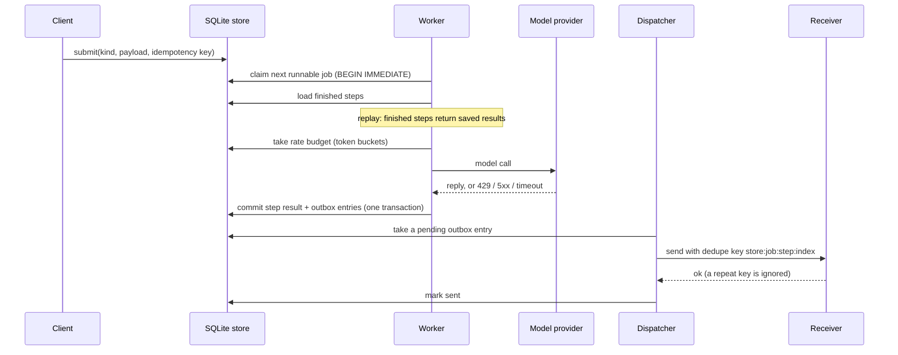

# agentqueue

[](https://github.com/shreyas-tech7/agentqueue/actions/workflows/ci.yml)

**Status:** v0.1.0-rc1, a release candidate. Every number below comes from a local fake provider with injected faults, not from a real model. The human checks are not done yet.

agentqueue runs LLM jobs that survive crashes, stay inside free-tier rate limits and never apply a side effect twice, as long as the receiver checks the dedupe key. All of its state lives in one SQLite file. It needs only the Python standard library.

## The problem

Agent runs fail in the middle. A provider returns 429, a call times out, the laptop sleeps, the process gets killed. If the runner keeps no record of finished work, a restart starts the job from the top. It pays for every model call again, and it sends every email again.

Durable execution fixes the first half. The runner saves the result of each finished step, so a restart repeats only the step that was running. The second half is harder. A step that sends an email can crash after the send and before the save. agentqueue handles that with an outbox: the step records the email in the same transaction as its result, and a separate dispatcher sends it with a dedupe key that the receiver checks.

The third problem is rate limits. Free tiers cap requests per minute, requests per day and tokens per minute. agentqueue keeps a token bucket for each limit in the same SQLite file, so a restarted worker cannot forget what it already spent.

## How it works



1. `submit` stores a job under its idempotency key. A second submit with the same key returns the same job.
2. A worker claims the next runnable job inside `BEGIN IMMEDIATE` and gets a lease token.
3. The worker runs the job function from the top. Each `ctx.step(name, fn)` that already finished returns its saved result. The first unfinished step runs.
4. A model call first takes a request and its tokens from the provider's buckets. If the budget is gone, the job waits and the worker moves on.
5. The step result and its outbox entries commit in one transaction.
6. The dispatcher sends each outbox entry and marks it sent. The receiver drops a key it has seen. An entry that hits a permanent error, or fails 20 times, moves to the outbox's dead list, and `requeue --outbox` sends it again.
7. An error goes to a retry with backoff, or to the dead-letter table. `requeue` brings a dead job back, and it resumes after its last finished step.

The job states form an explicit table in [src/agentqueue/states.py](src/agentqueue/states.py). Every state change goes through it.

## Results

Run on 2026-11-21 on Intel(R) Xeon(R) Processor @ 2.10GHz, 4 cores, Python 3.13.18. Model: none: the local fake provider, no real model. Seeds: 1, 2, 3, 4, 5. Each run: 60 jobs, 3 model steps and 1 side effect per job, 4 worker processes, limits 900 requests per minute and 60000 tokens per minute.

Each cell is the mean over the seeds, then a 95% t interval over the seeds in brackets, cut at 0 and at 100%. "Same on every seed" means every seed gave the same value, so the interval has no width. Duplicate effects count side effects the receiver applied twice: the same effect body under two different keys, which a key check cannot catch. Job latency runs from submit to finish, and all jobs are submitted at once at the start, so most of it is time spent in the queue behind the rate limit. Completion below 100% means a job used all its attempts under faults and kills and went dead, which is the designed end for that case. Limit breaks count every moment the request log broke a token bucket or a limit window, summed over all seeds. That audit is the check on the limit. The requests per minute column is the run's request count over its length, and a run shorter than a minute can average above the per-minute limit, because the bucket starts full: a full burst plus a minute's refill still fits inside the limit for any 60 second window.

| Fault level | Completion rate | Wasted calls per run | Duplicate effects | p50 job latency | p95 job latency | Requests per min, whole run (can top the limit on runs under a minute) | Limit breaks | Worker kills per run |
| --- | --- | --- | --- | --- | --- | --- | --- | --- |
| low | 100.0% (same on every seed) | 3.0 [0.7, 5.3] | 0 (same on every seed) | 9.2 s [8.6 s, 9.7 s] | 12.0 s [11.8 s, 12.3 s] | 956 [947, 964] | 0 | 10.2 [6.5, 13.9] |
| medium | 100.0% (same on every seed) | 3.6 [1.5, 5.7] | 0 (same on every seed) | 9.8 s [9.5 s, 10.2 s] | 13.3 s [12.6 s, 14.0 s] | 870 [781, 958] | 0 | 32.6 [29.0, 36.2] |
| high | 99.7% [98.7%, 100.0%] | 15.8 [9.3, 22.3] | 0 (same on every seed) | 12.0 s [11.4 s, 12.6 s] | 20.1 s [19.1 s, 21.1 s] | 279 [220, 338] | 0 | 134.8 [122.7, 146.9] |

The fault rates per model request and the worker kills:

| Level | 429 | 500 | Timeout | Slow | Dropped | Worker SIGKILL |
| --- | --- | --- | --- | --- | --- | --- |
| low | 2% | 2% | 1% | 2% | 1% | parent kill every 4 s on average, crash point 1 to 3000 |
| medium | 5% | 5% | 2% | 5% | 2% | parent kill every 2 s on average, crash point 1 to 1000 |
| high | 10% | 10% | 5% | 10% | 5% | parent kill every 1 s on average, crash point 1 to 400 |

Workers die two ways. The benchmark parent SIGKILLs a random worker at random times. And each worker process gets a crash point picked by the seed: at that crash point it SIGKILLs itself. A crash point is any claim, step boundary, finish or outbox send, so these kills land in the narrow gaps that random timing rarely hits. Every killed worker is restarted.

The outbox against an inline send. The same benchmark, with the side effect sent straight from inside the step and with no dedupe key:

| Fault level | Side effect path | Duplicate effects per run | Redeliveries per run |
| --- | --- | --- | --- |
| medium | outbox, dedupe key | 0 (same on every seed) | 0.0 (same on every seed) |
| medium | inline send, no key | 0.2 [0.0, 0.8] | not tracked |
| high | outbox, dedupe key | 0 (same on every seed) | 0.2 [0.0, 0.8] |
| high | inline send, no key | 0.2 [0.0, 0.8] | not tracked |

The inline path's duplicates are rare here, because a duplicate needs a kill in the short gap between the send and the step commit, and the interval includes zero. So this table alone does not prove the outbox is needed. The kill test below aims crash points at that gap on purpose, and its receiver caught every redelivery by dedupe key.

The kill test. `agentqueue killtest` ran 200 runs on 2026-11-21 (seeds 0 to 199). 200 runs lost a worker to SIGKILL, 499 kills in all. 600 jobs succeeded and 0 went dead. Jobs left in another state: 0. Workers that hung: 0. Finished steps that ran again: 0. Unfinished steps that ran again after a kill: 121. Side effects missing at the receiver: 0. Redeliveries the receiver caught by dedupe key: 19.

Source files: [results/bench.json](results/bench.json) and [results/killtest.json](results/killtest.json). A static page with the same tables opens from disk: [docs/index.html](docs/index.html). These numbers measure how the runner reacts to faults that a fake provider injects. They say nothing about any real model or provider.

## Cost per task

No money was spent. Every call went to the local fake provider. The table shows what a job costs in model requests, which is what a real free tier counts.

| Fault level | Model calls a job needs | Requests sent per finished job | Wasted calls per finished job |
| --- | --- | --- | --- |
| low | 3 | 3.24 | 0.05 |
| medium | 3 | 3.51 | 0.06 |
| high | 3 | 4.32 | 0.26 |

Wasted calls are replies the provider produced that the runner then lost: the worker died before it saved them, or the client had already timed out. On a paid provider each one is billed and thrown away.

## Run it in 10 minutes

You need Python 3.11 or newer and git. No keys and no network beyond the package install.

```bash
git clone https://github.com/shreyas-tech7/agentqueue.git
cd agentqueue
./init.sh                       # makes .venv, installs, lints, runs every test offline
source .venv/bin/activate

# Submit a job twice with the same key. You get one job.
agentqueue submit --kind classify --key ticket-1 --payload '{"ticket": "I was charged twice"}'
agentqueue submit --kind classify --key ticket-1 --payload '{"ticket": "I was charged twice"}'

# Run the kill test: 200 runs that SIGKILL the worker at random points.
agentqueue killtest --runs 200

# Run a small chaos benchmark (about a minute), then look at the queue.
agentqueue bench --levels medium --seeds 1-2 --jobs 30 --naive "" --out /tmp/bench.json
agentqueue status
```

To run your own jobs, write a function and register it:

```python
from agentqueue.worker import job

@job("triage")
def triage(ctx, payload):
    label = ctx.step("label", lambda: ctx.model(f"Label: {payload['text']}"))
    ctx.step("notify", lambda: ctx.emit("http://127.0.0.1:9000/hook", {"label": label}) or "queued")
    return label
```

Then start a worker with your module and a limits file such as [examples/limits.toml](examples/limits.toml):

```bash
agentqueue work --jobs mymodule --limits examples/limits.toml
```

## Limits

- One machine only. Workers share one SQLite file. There is no network protocol between them. A dead worker is spotted by its lease running out or by its process id being gone, and the process id check assumes every worker runs in the same process namespace. Do not point workers in separate containers at one file.
- Job code must be deterministic between steps. Replay runs the job function again from the top. Code that reads the clock or a random number outside a step can take a different path on replay and ask for a step that does not match the saved one. Put anything that varies inside a step.
- Side effects happen once only if the receiver checks the dedupe key. The dispatcher delivers at least once. No system can promise exactly once delivery to a receiver that cannot dedupe: the sender can always crash after the receiver acted and before it learned the result, and then it has to choose between sending again and maybe never sending.
- `synchronous=NORMAL` in WAL mode survives a process crash. A power cut can lose the last few commits. Set `synchronous=FULL` in `store.connect` if that matters to you.
- The token estimate for a call is the prompt length divided by four plus `max_tokens`. The tokens-per-minute guarantee holds for that estimate. Text in many non-English languages takes more tokens than the estimate, so set `tpm` lower for it.
- Every burst must sit below its limit, so a limit of 1 per minute or per day cannot be expressed.
- A step that already sent a model call and then runs out of budget waits in place, up to 120 seconds, so it does not lose the call it paid for. A longer wait ends the attempt.
- The benchmark uses a fake provider. A real provider has other fault patterns, and its limits are not always the ones it documents.
- At the higher fault levels, throughput falls well below the configured limit, because faults, backoff and kills eat time. The request log audit found no window above the limit at any level.

## Glossary

- **Durable step:** a unit of work whose result is saved once it finishes. It never runs again after that.
- **Replay:** running the job function again after a crash. Finished steps return their saved results.
- **Idempotency key:** a name the caller picks for a job. The same key always means the same job.
- **Outbox:** a table of side effects waiting to be sent. Entries commit with the step that made them.
- **Dedupe key:** the name of one side effect, `store:job:step:index`. The store part is a random id made when the SQLite file is created, so a reset database never reuses a key. The receiver ignores a key it has seen.
- **Token bucket:** a counter that refills at a steady rate up to a cap. Each request takes from it.
- **Full jitter:** a retry wait picked at random between zero and an exponential cap.
- **Circuit breaker:** a switch that stops calls to a provider after repeated failures, then lets one trial call through.
- **Dead letter:** a job that ran out of attempts or hit a permanent error, kept with its last error.
- **Lease:** a claim on a job that runs out. If the worker dies, another worker can take the job.

## Related work

Temporal, Inngest, DBOS, Restate, LangGraph checkpointers, Hatchet and Trigger.dev all offer durable execution. Each one stores its step record in a different place ([a comparison](https://hackernoon.com/durable-execution-for-ai-agents-langgraph-dbos-inngest-and-temporal-compared)). A short public post shows that a SQLite step wrapper fits in about 150 lines, and describes a restart without durable state that re-billed about $19 of finished LLM calls ([the post](https://hackernoon.com/you-dont-need-temporal-yet-durable-execution-for-ai-agents-in-150-lines)).

agentqueue adds rate budgets per provider that survive restarts, an outbox with dedupe keys, a dead-letter flow and a public chaos benchmark.

Use Temporal or DBOS instead when you run workers on more than one machine, when you need workflows that last for weeks with versioned code, when you want a web UI and history search, or when a team will run it in production. agentqueue is for one builder on one machine with free-tier limits.

## How this was built

AI agents wrote most of the code, the tests and the docs under Shreyas's direction. The build followed a written brief, which is saved word for word in [docs/build/BUILD_PROMPT.md](docs/build/BUILD_PROMPT.md). Every number in this README is written by `agentqueue readme` from the files in `results/`, and a test fails if the two disagree.

Human checks, not done yet:

- Shreyas reads the diff of `src/agentqueue/store.py` and `src/agentqueue/worker.py`.
- Shreyas runs `./init.sh` and `agentqueue killtest` on his own machine.
- Shreyas runs one job against a real free provider.

The decisions and their reasons are in [DECISIONS.md](DECISIONS.md). A plain tour of every file is in [docs/WALKTHROUGH.md](docs/WALKTHROUGH.md).

MIT license. See [LICENSE](LICENSE).
